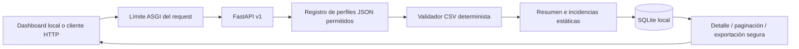

# Arquitectura técnica — Portfolio Local Release v1.0.0

## Componentes

- `main.py`: ciclo FastAPI, middleware de tamaño/encabezados, endpoints, status HTTP y dashboard.
- `profiles.py` + `profile_data/`: registro local, esquema JSON estricto y perfiles versionados.
- `validator.py`: reglas deterministas sin SQL ni HTTP.
- `store.py`: SQL parametrizado, conexiones por operación y transacciones.
- `db_maintenance.py`: integridad estructural/referencial y copia consistente a destinos nuevos.
- `csv_export.py`: streaming CSV y protección contra formula injection.
- `models.py`: contratos de respuesta Pydantic.
- `static/`: HTML/CSS/JS sin CDN, favicon y demos sintéticas de 6/100 pedidos, todo empacado en el wheel.
- `tests/`: unidades, integración ASGI/API, privacidad y concurrencia con bases temporales.
- `scripts/`: checks de versión, smoke HTTP, benchmark de validación/journal, CLI de mantenimiento y lanzador PowerShell local.

## Flujo de carga

1. `RequestBodyLimitMiddleware` inspecciona un `Content-Length` grande para rechazo temprano, pero siempre cuenta los chunks `http.request` reales. El máximo predeterminado es 2 MiB + 64 KiB.
2. Starlette procesa únicamente los chunks dentro de ese límite.
3. El endpoint comprueba el sufijo real, lee como máximo 2 MiB + 1 byte y cierra `UploadFile`.
4. Resuelve un perfil solo desde `PROFILE_FILES`; una ruta suministrada por el cliente nunca se abre.
5. La validación se ejecuta en threadpool y produce conteos/incidencias estáticas, no filas transformadas.
6. `save_run` inserta ejecución e incidencias en una sola transacción. Un fallo revierte todo.

## Perfiles

El JSON admite solo un conjunto fijo de operadores: requeridos, límites, identificadores, unicidad, email, política Decimal, enumeración y fecha ISO. El parser exige claves exactas, tipos, referencias a columnas obligatorias, ids versionados y ausencia de claves JSON duplicadas. Los archivos forman parte del paquete y no son contenido subido. `DATA_POLICY.md` define rango, escala, bytes y Unicode.

## Persistencia y concurrencia

- Tablas: `validation_runs` y `validation_issues`; no cambió el esquema desde v0.1.
- Una conexión por operación, `foreign_keys=ON`, cierre explícito y timeout de 5 segundos.
- `save_run` captura únicamente códigos primarios `SQLITE_BUSY/LOCKED` y los convierte en `StorageBusyError`; FastAPI retorna 503/`Retry-After`.
- Base nueva observada con `journal_mode=DELETE`/`synchronous=FULL`; el código no impone ni modifica el journal persistente.
- Soporte declarado: un worker, filesystem local y carga pequeña. WAL requiere evaluación; varios workers/escritura sostenida requieren PostgreSQL u otro diseño.
- El experimento lector/writer mostró 20/20 `BUSY` en DELETE y 20/20 commits en WAL, pero WAL no se adoptó porque faltan pruebas de checkpoint, cierre abrupto, Docker y volumen persistente.
- Backup/restauración usa `Connection.backup()`, `integrity_check`, `foreign_key_check` y creación exclusiva; nunca reemplaza la base activa.

## Lectura y exportación

`RunDetail` limita a 100 incidencias. El endpoint paginado permite hasta 500 por llamada. La exportación usa un cursor ordenado con `fetchmany(500)` y produce bytes fila por fila con UTF-8 BOM. Cada celda pasa por `safe_csv_cell`: para detectar un prefijo peligroso ignora whitespace y controles/formato Unicode iniciales; si encuentra `=`, `+`, `-` o `@`, antepone `'` al valor original. Las filas originales nunca están disponibles para exportar.

## Dashboard

FastAPI sirve `/` y assets empaquetados en `/static`. JavaScript usa `fetch`, `FormData` y `textContent`, no HTML de datos. El documento principal añade CSP básica y no depende de CDN. El backend añade `nosniff`, `DENY` para framing y política de referrer. Se ejecutó smoke HTTP con Uvicorn real y un navegador automatizado local para carga, error, historial, tabla, descarga, foco y breakpoints 360/390/768/1366.

El wheel final fue instalado en una venv independiente y encontró HTML, CSS, JavaScript, favicon, los dos perfiles y las demos 6/100 mediante `importlib.resources`.

## Seguridad y límites

- Loopback, nombre técnico, mensajes estáticos, cuerpo/archivo/filas acotados y SQL parametrizado.
- Docker preparado con usuario no root y `--workers 1`; build no verificado por ausencia de Docker.
- No autenticación/RBAC/TLS/retención/cifrado/rate limiting distribuido. Ver `SECURITY.md`.
- El techo del parser se alinea al máximo físico de 2 MiB; límites semánticos, importes e identificadores invisibles tienen contrato explícito.
- TestClient usa `httpx2` y quedó sin warnings en Python 3.12; el snapshot de constraints no reemplaza pruebas remotas 3.11.

## Alcance congelado

No se implementarán más funciones generales en este proyecto. Si un producto
posterior requiere concurrencia, identidad o ML, debe partir de requisitos y
evidencia nuevos. Los documentos de diseño históricos se conservan para
mostrar razonamiento, no como compromisos del roadmap v1.
